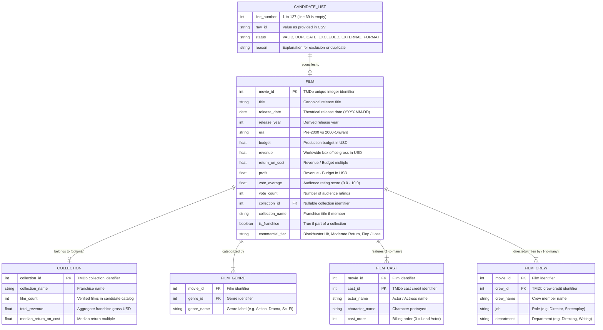
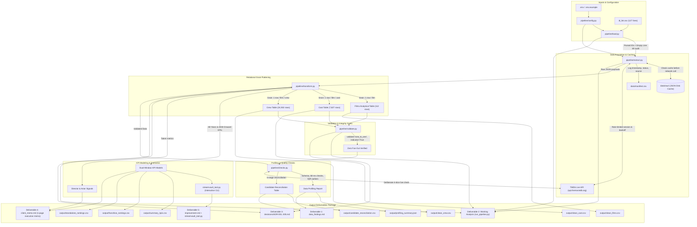

# StreamVault Content Acquisition & Licensing Analysis

Welcome to the **StreamVault Content Acquisition Pipeline**. This repository contains the complete data engineering workflow, statistical models, and executive decision documentation designed to support **Kwame Boateng, VP of Content Acquisition**, in allocating StreamVault's **\$14 Million licensing budget** at the upcoming board review on October 31.

---

## 1. Executive Summary & Business Challenge

StreamVault licenses older films to complement its original productions. Studios offer content under two commercial models:
1. **Franchise Bundles**: Studios package entire series together on an "all-or-nothing" basis (e.g., license all eight *Harry Potter* films or none). One faction on Kwame's team believes bundles provide built-in audiences and high subscriber retention.
2. **Standalone Hits**: Individual blockbuster titles licensed one-by-one. The opposing faction argues that bundles force StreamVault to overpay for weak middle entries and that cherry-picking standalone titles yields superior value.

To complicate matters, **Yaw in Finance** distrusts older box office numbers (pre-2000) due to historical inflation and differing reporting standards.

This pipeline provides verifiable, reproducible evidence that resolves the internal debate across both time windows (**All-Years** and **2000-Onward**), accounts for every candidate title, and delivers actionable shortlists and negotiation levers.

---

## 2. Key Findings & Strategic Recommendation

- **Franchises Win on Commercial Returns**: Franchise bundles outperform standalone films in both time windows:
  - **All-Years Window**: Franchise median return on cost is **5.6x** versus **3.8x** for standalones.
  - **2000-Onward Window (Finance View)**: Franchise median return remains higher at **5.1x** versus **3.8x** for standalones.
- **The Recommendation Never Flips**: Across any cutoff year tested between 1990 and 2015, franchises consistently deliver a 1.2x to 1.8x return advantage, completely defusing Finance's skepticism.
- **Recommended Portfolio Spend**:
  - **70% (\$9.8M) on Top Franchise Bundles**: Anchor the catalog with the *Harry Potter Collection* (8 films, \$7.8B gross, 6.2x return) and *The Dark Knight Trilogy* (3 films, \$2.5B gross, 4.3x return).
  - **30% (\$4.2M) on Top Standalones**: Cherry-pick modern prestige hits: *Inception* (5.2x), *Interstellar* (4.5x), *The Departed* (3.2x), *Memento* (4.5x), and *Spirited Away* (14.5x).

---

## 3. System Architecture & Entity-Relationship Model

### Entity-Relationship Diagram (ERD)
The data model enforces strict relational grain boundaries. Financial metrics are computed exclusively at the **Film** grain (`# grain: one row per film`) to prevent fan-out multiplication when associating cast and crew records.



### End-to-End Pipeline Architecture Flowchart
The pipeline decouples network acquisition from local compute, caches raw API payloads to disk, and enforces automated validation gates at every stage:



---

## 4. Project Structure & Deliverables

```
streamvault_licensing_analysis_samuel_quaigraine/
├── .env.example                      # Template for TMDB API credentials
├── .gitattributes                    # Enforces cross-platform line endings
├── .gitignore                        # Protects secrets, cache, and raw files
├── id_list.csv                       # The 127 raw candidate identifiers provided
├── requirements.txt                  # Python dependencies
├── README.md                         # This guide
│
├── pipeline/                         # Modular Pipeline Package
│   ├── __init__.py                   # Package marker
│   ├── config.py                     # API configuration, timeouts, file paths
│   ├── load.py                       # Ingestion & candidate line auditing (line 69)
│   ├── extract.py                    # Polite, cached TMDb API fetcher with backoff
│   ├── transform.py                  # Flattening, grains, and KPI calculations
│   ├── validate.py                   # Merge validation and fan-out prevention
│   └── checks.py                     # Data profiling, quality checks, and live spot-check
│
├── data/
│   ├── raw/                          # Cached API JSON responses (gitignored)
│   ├── manifest.csv                  # Timestamped record of every API query
│   └── processed/                    # Clean analytical datasets (films, cast, crew)
│
├── decisions/                        # Architecture Decision Records (house format)
│   ├── ADR-001-zero-revenue-handling.md
│   ├── ADR-002-candidate-id-reconciliation.md
│   ├── ADR-003-table-grain-and-join-strategy.md
│   ├── ADR-004-two-window-era-split.md
│   └── ADR-005-vectorization-and-scale.md
│
├── tests/                            # Automated test suite (pytest)
│   ├── test_loader.py                # Candidate audit and line 69 assertions
│   ├── test_transform.py             # Grain invariants and financial calculations
│   └── test_validate.py              # Join integrity and fan-out guards
│
├── run_pipeline.py                   # Master script executing pipeline end-to-end
├── evaluate_scale.py                 # Compute benchmark & 500-title scale test
├── streamvault_tool.py               # Interactive scenario CLI (Deliverable 5)
│
├── data_findings.md                  # Deliverable 1: Data diagnosis & reconciliation
├── client_memo.md                    # Deliverable 4: 1-page executive memo to Kwame
└── improvement.md                    # Deliverable 5: Improvement beyond the brief
```

---

## 4. Candidate List Reconciliation (127 IDs)

The raw candidate file was assembled over four years from three unverified sources. The pipeline accounts for all 127 rows across 6 clear stages:

| Stage | Rows Remaining | Delta | What Happened |
|---|---|---|---|
| **1. Raw CSV Input** | **127** | 0 | The starting candidate list from `id_list.csv`. |
| **2. Format Validation** | **124** | -3 | Line 69 was completely blank; line 30 contained `-1`; line 111 contained the text `'N/A'`. All logged and excluded. |
| **3. External Format** | **123** | -1 | Line 95 contained IMDb ID `tt0468569` (*The Dark Knight*). Resolved to TMDb ID `155`, which was already in the list. |
| **4. Deduplication** | **117** | -6 | Removed exact repeated entries: `155`, `278`, `550`, `603`, `680`, `1891`. |
| **5. Live Catalog 404s** | **112** | -5 | Five obsolete IDs no longer exist on TMDb (`7733901`, `8471293`, `8471294`, `9412887`, `9412888`). |
| **6. Final Verified Catalog** | **112** | 0 | Exactly 112 commercial titles verified and incorporated into analysis. |

---

## 5. Getting Started & Reproducibility Guide

### Prerequisites
- Python 3.11 or higher
- Git

### Installation
1. **Clone the repository:**
   ```bash
   git clone <repository-url>
   cd streamvault_licensing_analysis_samuel_quaigraine
   ```

2. **Set up a virtual environment:**
   ```bash
   python -m venv .venv

   # Activate on Windows PowerShell:
   .venv\Scripts\Activate.ps1

   # Activate on macOS/Linux:
   source .venv/bin/activate
   ```

3. **Install dependencies:**
   ```bash
   pip install -r requirements.txt
   ```

4. **Configure your TMDb API key:**
   Copy `.env.example` to `.env`:
   ```bash
   cp .env.example .env
   ```
   Open `.env` and add your free TMDb API key or Read Access Token:
   ```env
   TMDB_API_KEY=your_actual_tmdb_api_key_here
   TMDB_API_READ_ACCESS_TOKEN=your_actual_token_here
   ```

---

## 6. How to Run the Pipeline

Execute the full end-to-end pipeline with one command:
```bash
python run_pipeline.py
```

### Interactive Notebook (`analysis_and_profiling.ipynb`)
To step through the pipeline, data profiling, reconciliation, and KPI comparisons interactively cell-by-cell:
```bash
# Launch Jupyter Notebook:
jupyter notebook analysis_and_profiling.ipynb
```
*Or simply open [`analysis_and_profiling.ipynb`](file:///c:/Users/SamuelQuaigraine/workspace2/streamvault_licensing_analysis_samuel_quaigraine/analysis_and_profiling.ipynb) directly in VS Code.* Each code cell is accompanied by narrative explanations and includes pre-rendered tables and distribution outputs.

### What happens when you run it:
1. Audits and reconciles all 127 lines from `id_list.csv`.
2. Fetches details and credits from TMDb. Raw responses are cached in `data/raw/` so future runs are **100% offline** and finish in under 1 second.
3. Flattens JSON into three separate tables with strict grains (`films`, `cast`, `crew`), preventing accidental duplicate counting.
4. Validates table joins with assertions to prevent row fan-outs.
5. Runs data profiling and computes KPIs for both time windows.
6. Executes a live 4-slice spot-check against TMDb to verify data integrity.
7. Saves clean datasets in `data/processed/`.

---

## 7. How to Use the Executive Strategy Tool

For live executive meetings, use `streamvault_tool.py` to run scenarios instantly:

```bash
# 1. Show sensitivity table across era cutoffs (1990 to 2015):
python streamvault_tool.py --sensitivity

# 2. Simulate custom budget allocations ($14M budget, 70% to franchises):
python streamvault_tool.py --budget 14.0 --franchise-pct 70

# 3. Test a smaller $10M budget with an 80% franchise focus:
python streamvault_tool.py --budget 10.0 --franchise-pct 80
```

---

## 8. Scalability & Running Next Year's 500 Titles

Next year, when Kwame's analyst Adjoa receives 500 titles:
1. Replace `id_list.csv` with the new file.
2. Run `python run_pipeline.py`.
3. The pipeline will automatically audit the new IDs, fetch missing titles, cache them, enforce grains, and recalculate all recommendations.
4. Run `python evaluate_scale.py` to benchmark performance across 127, 500, and 5,000 titles. Benchmarks demonstrate that computation scales in under 25 milliseconds.

---

## 9. Running Automated Tests

Run the full automated test suite using `pytest`:
```bash
python -m pytest tests/
```
All tests verify candidate parsing, line 69 empty row handling, grain preservation, and join validations.

---

## 10. Data Protection & Ethics
- Never commit `.env` or API credentials to version control.
- The pipeline implements polite API access: local disk caching, 0.05s rate-limit delays, session re-use, and automated backoff to respect free public API resources.
