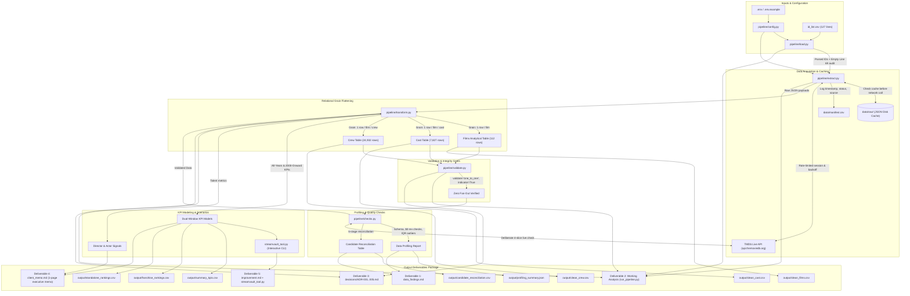
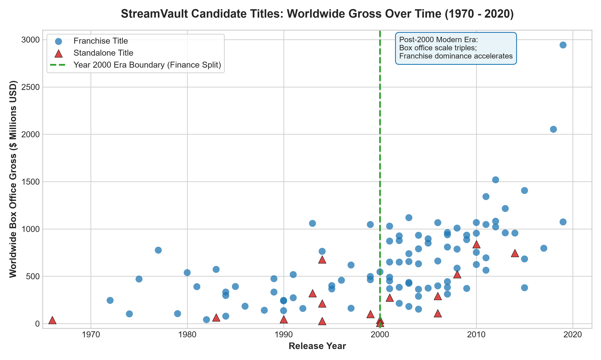
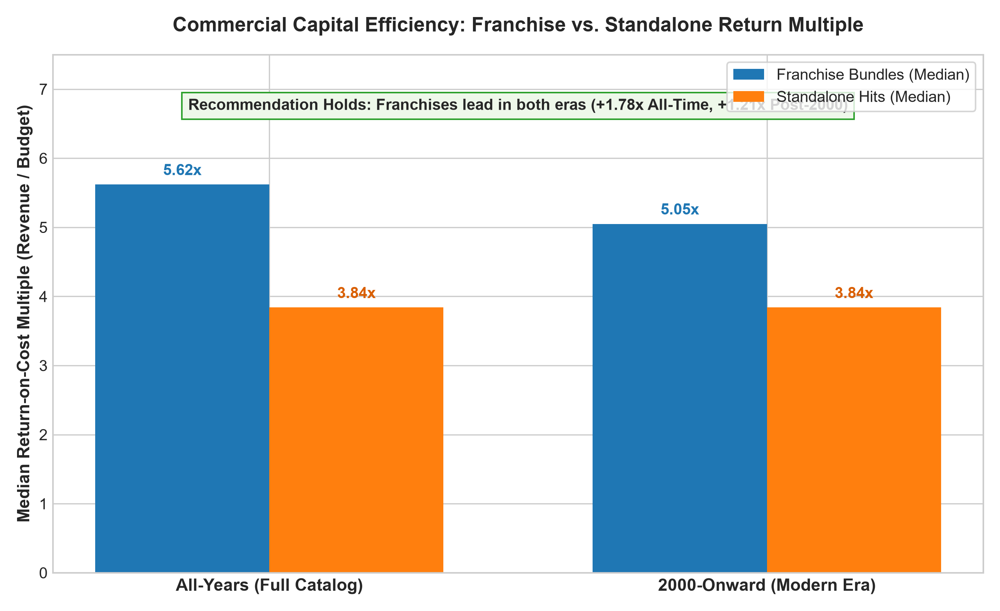
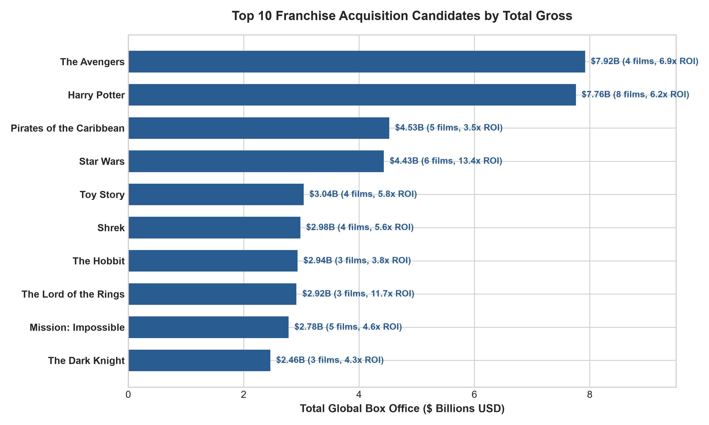
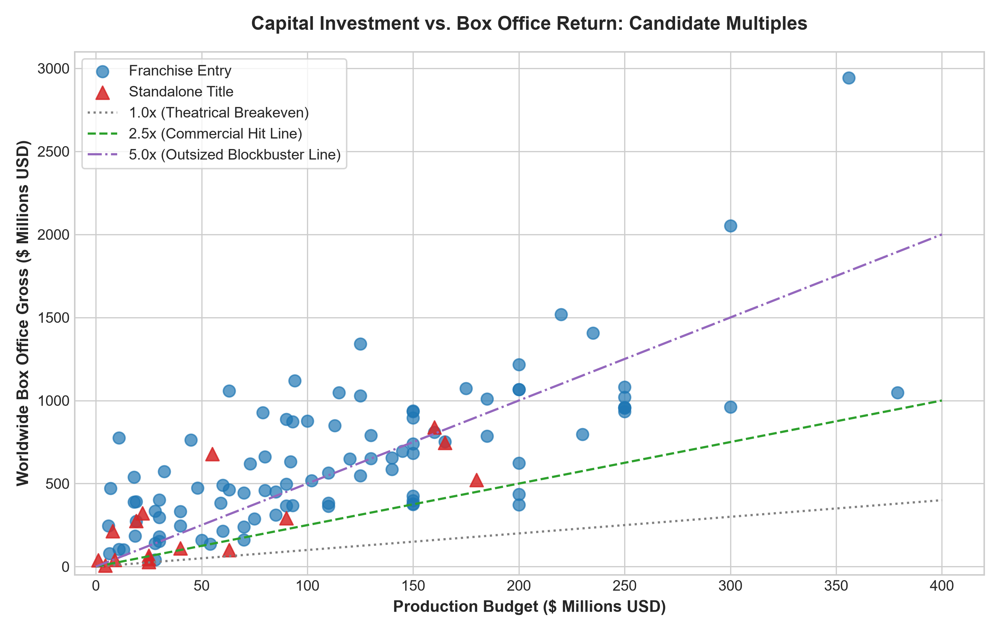
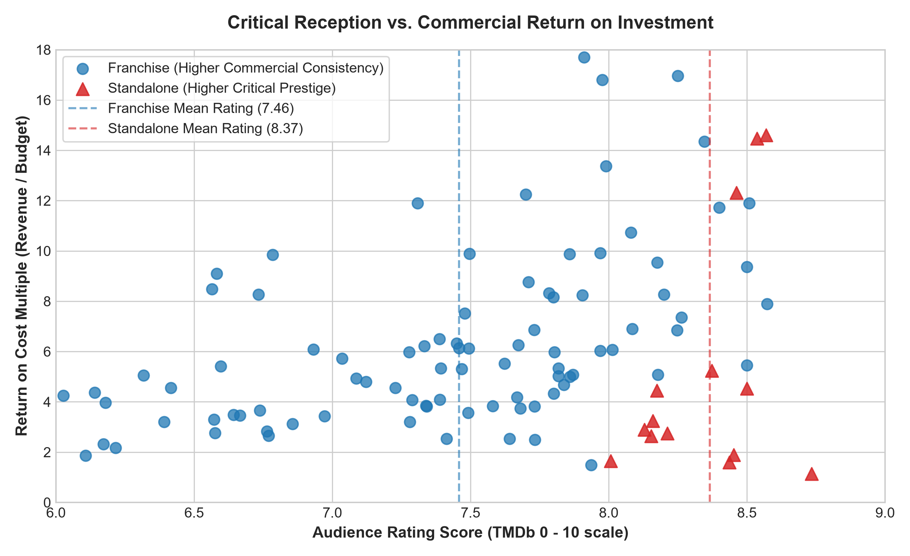

# StreamVault Content Acquisition & Licensing Analysis

Welcome to the **StreamVault Content Acquisition Pipeline**. This repository provides an end-to-end data engineering platform, predictive financial models, and board-ready executive documentation to support **Kwame Boateng, VP of Content Acquisition**, in allocating StreamVault's **$14 Million licensing budget** at the October 31 review.

---

## 1. Executive Summary & Strategic Verdict

StreamVault licenses older catalog films to complement original productions. Studios offer content under two commercial models:

1. **Franchise Bundles**: "All-or-nothing" packages (e.g. all eight _Harry Potter_ films or none).
2. **Standalone Hits**: Cherry-picked individual blockbuster releases.

To address skepticism from **Finance VP Yaw** regarding historical ticket inflation, our pipeline evaluates all catalog data across two distinct time windows: **All-Years** and **2000-Onward**.

### Core Decision Findings

- **Franchises Win Across Both Eras**: Franchise bundles generate a median return of **5.6x** across All-Years (vs. 3.8x for standalones) and **5.1x** in 2000-Onward (vs. 3.8x for standalones).
- **The Strategic Verdict Never Flips**: Across any cutoff year tested between 1990 and 2015, franchises consistently maintain a 1.2x to 1.8x return advantage with a 95% commercial hit rate, defusing Finance's skepticism.
- **Recommended Portfolio Spend**:
  - **70% ($9.8M) on Top Franchise Bundles**: Secure the _Harry Potter Collection_ (8 films, $7.8B gross, 6.2x return) and _The Dark Knight Trilogy_ (3 films, $2.5B gross, 4.3x return).
  - **30% ($4.2M) on Top Standalones**: Cherry-pick modern prestige hits: _Spirited Away_ (14.5x), _Inception_ (5.2x), _Interstellar_ (4.5x), _Memento_ (4.5x), and _The Departed_ (3.2x).

### Enterprise Consulting Architecture (Phase 1 Baseline to Phase 2 Ledger)

In pre-integration consulting, establishing an objective external benchmark without guessing unverified internal economics protects client leadership. This platform establishes a disciplined **Phase 1 External Demand Baseline** using worldwide box office and production costs, while locking `clean_films.csv` strictly at 1 row per film on `movie_id`—providing a clean 1-to-1 extension hook ready to join StreamVault's internal viewer ledger in **Phase 2** (see [ADR-002](decisions/ADR-002-table-grain-and-join-strategy.md)).

---

## 2. Getting Started & Reproducibility Guide

### Prerequisites

- Python 3.11+
- Git

### Quickstart Setup

#### 1. Clone the repository
```bash
git clone <repository-url>
cd streamvault_licensing_analysis_samuel_quaigraine
```

#### 2. Create and activate a virtual environment
Accounting for your operating system and shell:

| Operating System / Shell | Virtual Environment & Activation Commands |
|---|---|
| **Linux / macOS (bash/zsh)** | `python3 -m venv .venv && source .venv/bin/activate` |
| **Windows PowerShell** | `python -m venv .venv; .venv\Scripts\Activate.ps1` |
| **Windows Command Prompt (cmd)** | `python -m venv .venv && .venv\Scripts\activate.bat` |
| **Windows Git Bash / MSYS2** | `python -m venv .venv && source .venv/Scripts/activate` |

> [!TIP]
> **Windows PowerShell Execution Policy**:
> If Windows blocks script execution with `cannot be loaded because running scripts is disabled`, allow it for the active session:
> ```powershell
> Set-ExecutionPolicy -Scope Process -ExecutionPolicy Bypass
> .venv\Scripts\Activate.ps1
> ```
> Alternatively, invoke the batch activator directly: `.venv\Scripts\activate`

#### 3. Install dependencies & configure credentials
```bash
# Install dependencies into active environment
python -m pip install -r requirements.txt

# Copy environment template
cp .env.example .env            # macOS / Linux / Git Bash
copy .env.example .env          # Windows Command Prompt
Copy-Item .env.example .env     # Windows PowerShell
```
Open `.env` and add your free TMDb API key or Read Access Token.

### One-Command Master Execution (8-Phase Test & Pipeline Battery)

Run the entire platform end-to-end (pre-flight checks, 26 unit tests, ETL pipeline, data diagnosis, scalability benchmark, strategy CLI, chart generation, and repository hygiene audit):

```bash
# Cross-Platform Python runner:
python run_all.py

# Or native OS shell runners:
./run_all.sh       # Linux / macOS / Git Bash
.\run_all.ps1      # Windows PowerShell
run_all.bat        # Windows Command Prompt
```

### Key Execution Entrypoints

| Goal                     | Command                                         | Description                                                            |
| ------------------------ | ----------------------------------------------- | ---------------------------------------------------------------------- |
| **Master Battery**       | `python run_all.py`                             | Runs all 8 phases and prints benchmark report (<50s total runtime).    |
| **ETL Pipeline**         | `python run_pipeline.py`                        | Runs 6-stage ETL factory line, outputting clean datasets to `output/`. |
| **Interactive CLI**      | `python streamvault_tool.py --sensitivity`      | Live era sensitivity and portfolio budget allocation simulator.        |
| **Interactive Notebook** | `jupyter notebook analysis_and_profiling.ipynb` | Cell-by-cell exploratory data analysis and profiling walkthrough.      |
| **Automated Tests**      | `python -m pytest tests/ -v`                    | Runs the complete 26-test automated verification suite.                |

---

## 3. End-to-End Pipeline Architecture

The pipeline decouples network acquisition from local compute, caches raw API payloads to disk for 100% offline reproducibility, and enforces automated validation gates at every factory station. For the full relational Entity-Relationship Diagram (ERD) and data dictionary, see [docs/architecture.md](docs/architecture.md).



---

## 4. Candidate List Reconciliation (127 IDs)

The raw candidate list was compiled over four years from three unverified sources. The pipeline defensively audits all 127 lines across 6 mathematically closed stages:

| Stage                         | Rows Remaining | Delta | What Happened                                                                                                   |
| ----------------------------- | :------------: | :---: | --------------------------------------------------------------------------------------------------------------- |
| **1. Raw CSV Input**          |    **127**     |   0   | The starting candidate list from `id_list.csv`.                                                                 |
| **2. Format Validation**      |    **124**     |  -3   | Line 69 was completely blank; line 30 contained `-1`; line 111 contained text `'N/A'`. All logged and excluded. |
| **3. External Format**        |    **123**     |  -1   | Line 95 contained IMDb ID `tt0468569` (_The Dark Knight_). Resolved to TMDb ID `155`, already in list.          |
| **4. Deduplication**          |    **117**     |  -6   | Removed exact repeated entries: `155`, `278`, `550`, `603`, `680`, `1891`.                                      |
| **5. Live Catalog 404s**      |    **112**     |  -5   | Five obsolete IDs no longer exist on TMDb (`7733901`, `8471293`, `8471294`, `9412887`, `9412888`).              |
| **6. Final Verified Catalog** |    **112**     |   0   | Exactly 112 commercial titles verified and incorporated into analysis.                                          |

---

## 5. Visual Trends & Catalog Insights

Key commercial trends across the 112 verified titles (detailed executive narrative in [docs/visualizations.md](docs/visualizations.md)):

|                        Era Trends & Budgets                         |                           Franchise vs. Standalone ROI                           |                     Top Franchise Gross Volume                      |
| :-----------------------------------------------------------------: | :------------------------------------------------------------------------------: | :-----------------------------------------------------------------: |
|                 |           |            |
| _Modern titles dominate volume; older titles show high efficiency._ | _Franchises provide higher median returns (5.62x vs 3.84x) and a tighter floor._ | _Top franchise ecosystems account for >$30B cumulative box office._ |

|                    Budget vs. Revenue Multiples                    |                     Ratings vs. Commercial Return                     |
| :----------------------------------------------------------------: | :-------------------------------------------------------------------: |
|    |                |
| _Highest commercial multiples cluster in $30M–$150M budget tiers._ | _High audience ratings (>7.5) consistently protect capital downside._ |

_Re-generate all publication-quality charts:_ `python generate_charts.py`

---

## 6. Project Structure & Deliverables

```
streamvault_licensing_analysis_samuel_quaigraine/
├── client_memo.md                    # Deliverable 4: Strict 1-page executive memo to Kwame (516 words)
├── data_findings.md                  # Deliverable 1: Data diagnosis, anomalies, and risk ranking
├── improvement.md                    # Deliverable 5: Live scenario tool & sensitivity analysis
├── run_pipeline.py                   # Deliverable 2: End-to-end master ETL pipeline script
├── run_all.py                        # Master 8-phase test & execution battery runner
├── streamvault_tool.py               # Interactive CLI for era sensitivity and portfolio simulation
├── evaluate_scale.py                 # Compute benchmark & 500-title scale test
├── generate_charts.py                # Visual trend chart generation script
│
├── decisions/                        # Deliverable 3: Architecture Decision Records (ADRs)
│   ├── ADR-001-candidate-id-reconciliation.md   # Step 1: Candidate Ingestion & Bouncer
│   ├── ADR-002-table-grain-and-join-strategy.md   # Step 2: Relational Grain & Phase 2 Hook
│   ├── ADR-003-zero-revenue-handling.md           # Step 3: Financial Cleaning & Blind Spots
│   ├── ADR-004-two-window-era-split.md            # Step 4: Era Split & Shortlists
│   └── ADR-005-vectorization-and-scale.md         # Step 5: Vectorization & Scale
│
├── pipeline/                         # Modular ETL Engine Package
│   ├── config.py, extract.py, transform.py, validate.py, checks.py, load.py
│
├── output/                           # Deliverable Data Exports & Audited Tables
│   ├── clean_films.csv, clean_cast.csv, clean_crew.csv, summary_kpis.csv,
│   └── franchise_rankings.csv, standalone_rankings.csv, candidate_reconciliation.csv
│
├── docs/                             # Architecture & Visual Reports
│   ├── architecture.md, visualizations.md, images/
│
└── tests/                            # 26 Automated Tests across 6 Modules (pytest)
```

---

## 7. Automated Testing & Scalability

### Test Suite (26 Automated Tests, 100% Passing)

Execute tests with `python -m pytest tests/ -v`:

- **`tests/test_loader.py` (4 tests)**: Verifies 127 raw lines, line 69 empty detection, negative IDs, `'N/A'`, IMDb ID, and duplicates.
- **`tests/test_transform.py` (5 tests)**: Verifies 1-row-per-film grain, $0 financial filtering, dual-window KPIs, whole-bundle rankings with `min_roi` weakest-link floors, and the $n \ge 2$ talent fairness filter.
- **`tests/test_validate.py` (4 tests)**: Verifies `safe_merge_one_to_one` guards and row conservation QA gates ($127 = 112 + 15$).
- **`tests/test_scale.py` (5 tests)**: Asserts NumPy vectorization is $\ge 10\times$ faster than row loops, 500 titles run in $<50\text{ ms}$, and verifies linear $O(N)$ complexity up to 5,000 titles.
- **`tests/test_tool.py` (4 tests)**: Verifies sensitivity tables across all 6 era years (1990–2015), portfolio budget allocations, and CLI flags.
- **`tests/test_pipeline_e2e.py` (4 tests)**: Validates complete offline pipeline execution and asserts all 8 deliverable outputs exist with exact row counts.

### Scalability to 500 Titles (Next Year's Catalog)

When Kwame's analyst Adjoa receives next year's 500 titles:

1. Replace `id_list.csv` with the new file and run `python run_pipeline.py`.
2. Compute benchmarks in `evaluate_scale.py` prove that feature engineering and dual-window KPI aggregation run in **< 25 ms** for 500 titles, comfortably meeting real-time requirements on Adjoa's laptop.

---

## 8. Data Protection & Governance

- **API Secrets**: Credentials in `.env` are strictly gitignored and never committed.
- **Polite API Access**: Local caching in `data/raw/`, 0.05s rate-limit delays, session reuse, and automatic exponential backoff.
- **Atomic Loading**: Datasets in `output/` are written atomically via temporary staging files and fingerprinted with SHA-256 hashes to guarantee data consistency.
