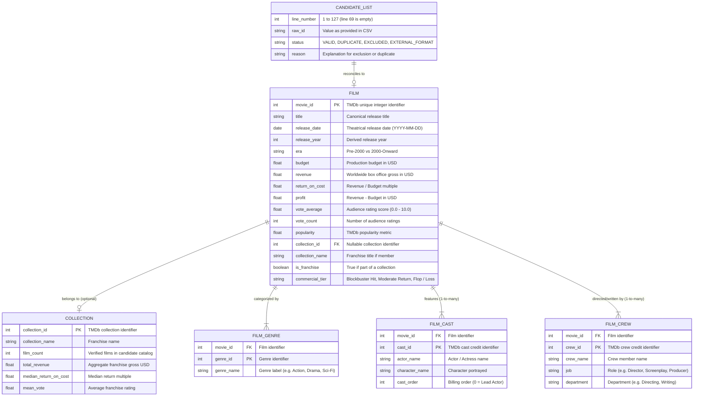
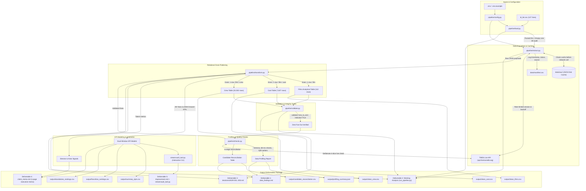
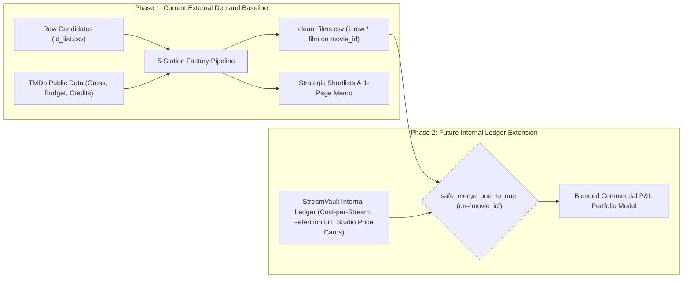

# StreamVault System Architecture & Entity-Relationship Model

This document provides the visual architectural blueprints, Entity-Relationship Diagram (ERD), and data dictionary for the StreamVault Content Acquisition Pipeline.

---

## 1. Entity-Relationship Diagram (ERD)

The data model enforces strict grain isolation and referential integrity. Financial metrics exist exclusively at the **FILM** grain (`# grain: one row per film`) to prevent fan-out multiplication when associating cast and crew records.

---

## 2. End-to-End Pipeline Architecture Flowchart

The pipeline decouples network acquisition from local computation, guarantees idempotent execution, and enforces automated quality gates at every transformation step.

---

## 3. Data Dictionary: Processed Analytical Tables

### Table 1: `clean_films.csv` (`# grain: one row per film`)
- **`movie_id`** (Integer, Primary Key): Unique TMDb movie identifier.
- **`title`** (String): Official English release title.
- **`original_title`** (String): Original language title.
- **`release_date`** (Date String, `YYYY-MM-DD`): Theatrical premiere date.
- **`release_year`** (Integer): Extracted 4-digit release year.
- **`era`** (Categorical): `"2000-Onward"` if release year >= 2000, else `"Pre-2000"`.
- **`budget`** (Float, USD): Production budget as reported by studio filings.
- **`revenue`** (Float, USD): Worldwide cumulative theatrical box office gross.
- **`profit`** (Float, USD): Net gross `Revenue - Budget`.
- **`return_on_cost`** (Float): Return multiple `Revenue / Budget`.
- **`commercial_tier`** (Categorical): Categorization:
  - `Blockbuster Hit`: `Return >= 2.5x`
  - `Moderate Return`: `1.0x <= Return < 2.5x`
  - `Flop / Loss`: `Return < 1.0x`
- **`runtime`** (Float, Minutes): Feature film duration in minutes.
- **`vote_average`** (Float): Audience score average on a 10-point scale.
- **`vote_count`** (Integer): Total audience ratings submitted.
- **`popularity`** (Float): TMDb engagement and page-view index.
- **`status`** (String): Release status (e.g., `"Released"`).
- **`collection_id`** (Integer, Nullable Foreign Key): ID of parent franchise collection, or null if standalone.
- **`collection_name`** (String, Nullable): Name of franchise collection (e.g., `"Harry Potter Collection"`).
- **`is_franchise`** (Boolean): `True` if member of a collection; `False` if standalone film.
- **`genres_count`** (Integer): Number of assigned genre categories.
- **`genre_names`** (String): Comma-delimited list of genre labels.

### Table 2: `clean_cast.csv` (`# grain: one row per film per cast member`)
- **`movie_id`** (Integer, Foreign Key): References `clean_films.csv`.
- **`cast_id`** (Integer, Primary Key): TMDb actor credit identifier.
- **`actor_name`** (String): Billed name of the performer.
- **`character_name`** (String): Name of the role portrayed.
- **`cast_order`** (Integer): Order in the credits billing (0 = Top-billed Lead Actor).

### Table 3: `clean_crew.csv` (`# grain: one row per film per crew member`)
- **`movie_id`** (Integer, Foreign Key): References `clean_films.csv`.
- **`crew_id`** (Integer, Primary Key): TMDb crew credit identifier.
- **`crew_name`** (String): Name of the crew member.
- **`job`** (String): Specific credit (e.g., `"Director"`, `"Screenplay"`, `"Original Music Composer"`).
- **`department`** (String): Functional department (e.g., `"Directing"`, `"Writing"`).

---

## 4. Two-Phase Enterprise Content Architecture: Pre-Integration Baseline to Internal Ledger Extension

The data platform is intentionally engineered across two distinct commercial phases to mirror real-world consulting practice:

### Architectural Principles:
1. **Phase 1 (External Market Demand Baseline)**:
   - Evaluates historical market demand, capital efficiency (`Revenue / Budget`), and creative talent consistency from public records.
   - Operates 100% offline from verified JSON disk cache.
   - Prepares Kwame Boateng with an unbiased, mathematically reconciled allocation strategy for the October 31 board review without fabricating internal streaming economics.
2. **Phase 2 (Internal Streaming & Deal Ledger Integration)**:
   - Because `clean_films.csv` strictly enforces `# grain: one row per film` on `movie_id`, it serves as an extensible integration hook.
   - When internal telemetry (e.g. streaming hours, subscriber retention lift) and studio licensing rate cards are finalized, they join directly via `movie_id` (`validate="one_to_one"`).
   - Zero refactoring of Station 1 (The Bouncer), Station 2 (The Labeler), or Station 3 (The Quality Filter) is required.
